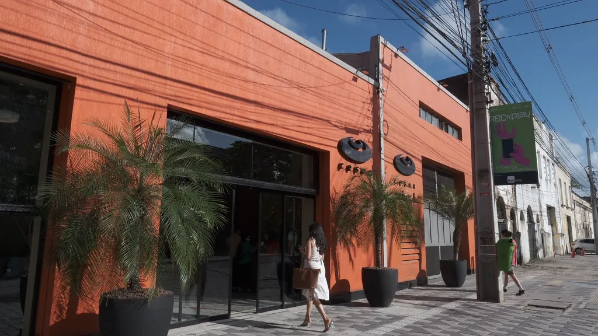
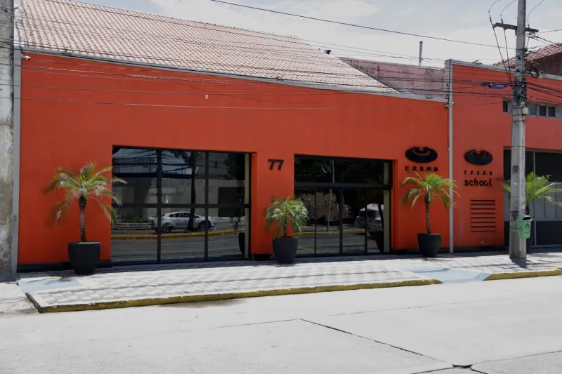

# Novas características de imagem para monitoramento do servidor

**Autores:**
- Helder Cordeiro de Barros Filho
- Lucas Rafael Gomes Maia da Silva

## Contexto

Na [aula 011](https://github.com/lgallindo/bentoML-processamento-imagens/tree/main/011_corpus_histograms_model), o `image_extract.py` extrai de cada imagem os histogramas dos canais **L**, **R**, **G** e **B** do Pillow e calcula a média de cada um.
O canal L vem de `image.convert("L")`, que aplica a luma da Rec. BT.601 ([Luma](https://en.wikipedia.org/wiki/Luma_%28video%29)):

```
L = 0.299·R + 0.587·G + 0.114·B
luminance_mean = (Σ i · counts[i]) / (Σ counts[i])
```

As médias dizem *quão clara* e *para que cor puxa* a imagem. Elas não percebem três falhas comuns de entrada num servidor de visão:

| Falha na entrada | As médias L/R/G/B percebem? |
|---|---|
| Imagem sem contraste (lavada, neblina, contraluz) | Não. Mesma média com dispersão diferente |
| Imagem sem cor (P&B) ou com cor saturada/artificial | Só parcialmente |
| Imagem desfocada / tremida | **Não.** Borrar não altera as médias (ver a validação abaixo) |

Por isso propomos três características novas, cada uma voltada para uma dessas falhas.

> **Ferramenta de IA utilizada:** Claude Code (Anthropic, modelo Claude Opus). Ela leu o código da aula 011, escreveu o código de extração e o executou nas imagens e no corpus.

## Definição das características

### 1. Contraste RMS (`contrast_rms`, numérica)

É o desvio-padrão do canal L. É calculado **a partir do mesmo histograma** que a aula já usa para `luminance_mean`:

```
μ = (Σ i · counts[i]) / N
contrast_rms = sqrt( Σ counts[i] · (i − μ)² / N )
```

- O valor vai de 0 (imagem uniforme) a ~128 (só preto e branco puros).
- Valores baixos indicam imagem lavada, com neblina ou mal exposta.
- A média diz onde o histograma está; o contraste diz quão espalhado ele é.

### 2. Colorido de Hasler & Süsstrunk (`colorfulness` numérica + `colorfulness_class` categórica)

Usa dois canais oponentes de **crominância** ([Chrominance](https://en.wikipedia.org/wiki/Chrominance)):

```
rg = R − G
yb = ½(R + G) − B
colorfulness = sqrt(σ_rg² + σ_yb²) + 0.3 · sqrt(μ_rg² + μ_yb²)
```

- Vale **0** para imagens em tons de cinza e cresce com a saturação e a variedade de cores.
- A versão categórica usa as faixas do artigo original:

| colorfulness | classe |
|---|---|
| < 15 | nada colorida |
| 15–33 | pouco colorida |
| 33–45 | moderadamente colorida |
| 45–59 | medianamente colorida |
| 59–82 | bastante colorida |
| 82–109 | muito colorida |
| ≥ 109 | extremamente colorida |

Referência: D. Hasler, S. Süsstrunk, *Measuring colourfulness in natural images*, Proc. SPIE 5007, 2003.

### 3. Nitidez: variância do Laplaciano (`sharpness_lapvar` numérica + `is_blurry` categórica)

Aplica o Laplaciano 4-vizinhos sobre o canal L e calcula a variância da resposta:

```
kernel = [[0, 1, 0],
          [1,−4, 1],
          [0, 1, 0]]

sharpness_lapvar = Var( kernel ∗ L )
is_blurry        = sharpness_lapvar < 100
```

- O Laplaciano responde a bordas e texturas finas. Uma imagem desfocada tem poucas delas, então a variância fica baixa.
- O limiar 100 é o valor empírico usual. Num sistema real ele deve ser calibrado pelo corpus; o p05 do corpus de praias é 133.

## Código de extração

Arquivo: [extract_features.py](extract_features.py). Ele segue a estrutura do `image_extract.py` da aula:
- usa o mesmo canal L do Pillow e o mesmo cálculo pelo histograma;
- grava um `features/<stem>.json` por imagem;
- depende só de **Pillow + NumPy**. O NumPy já é instalado junto com o BentoML.

O `luminance_mean` calculado aqui confere com o da aula. Na imagem `001-a-bike-on-the-beach…jpg` os dois dão `101.06526041666666`.

Trechos principais:

```python
def histogram_mean(counts):
    total = sum(counts)
    return sum(i * c for i, c in enumerate(counts)) / total

def histogram_std(counts):
    total = sum(counts)
    mu = histogram_mean(counts)
    return (sum(c * (i - mu) ** 2 for i, c in enumerate(counts)) / total) ** 0.5

# 1 — contraste RMS
def contrast_rms(image):
    return histogram_std(image.convert("L").histogram())

# 2 — colorfulness
def colorfulness(image):
    rgb = np.asarray(image.convert("RGB"), dtype=np.float64)
    r, g, b = rgb[..., 0], rgb[..., 1], rgb[..., 2]
    rg = r - g
    yb = 0.5 * (r + g) - b
    return float(np.hypot(rg.std(), yb.std()) + 0.3 * np.hypot(rg.mean(), yb.mean()))

def colorfulness_class(value):
    return next(label for limit, label in COLORFULNESS_LEVELS if value < limit)

# 3 — nitidez
def sharpness_lapvar(image):
    y = np.asarray(image.convert("L"), dtype=np.float64)
    p = np.pad(y, 1, mode="edge")
    lap = p[:-2, 1:-1] + p[2:, 1:-1] + p[1:-1, :-2] + p[1:-1, 2:] - 4.0 * y
    return float(lap.var())

def extract_extra_features(image):
    c = colorfulness(image)
    s = sharpness_lapvar(image)
    return {
        "contrast_rms": contrast_rms(image),
        "colorfulness": c,
        "colorfulness_class": colorfulness_class(c),
        "sharpness_lapvar": s,
        "is_blurry": s < BLUR_THRESHOLD,
    }
```

O script também calcula uma **referência do corpus**: média e percentis p05/p50/p95 de cada característica sobre `samples/beaches/`. Com ela, marca cada imagem nova como `baixo`, `ok` ou `alto`, conforme saia ou não do intervalo [p05, p95].

Execução:

```bash
pip install pillow numpy
python extract_features.py images/*.webp --corpus corpus_beaches
```

A pasta `corpus_beaches/` não está versionada (ver `.gitignore`). Ela é uma cópia de [`samples/beaches/`](https://github.com/lgallindo/bentoML-processamento-imagens/tree/main/samples/beaches) do repositório da aula. Para reproduzir a comparação, copie essas imagens para `corpus_beaches/`. Sem `--corpus`, o script extrai só as características das imagens.

Saídas:
- [features/](features/): um JSON por imagem;
- [results.csv](results.csv): tabela das 3 imagens;
- [corpus_reference.json](corpus_reference.json): referência do corpus.

## Imagens utilizadas

São as três imagens de demonstração da pasta `011_corpus_histograms_model/samples/`:

| cesar-fachada-1.webp | cesar-school-fachada-predio-brum.webp | thumb-podcast-cesar-school-1.webp |
|---|---|---|
|  |  |  |
| Foto da fachada em perspectiva, céu azul, 1024×576 | Foto frontal da fachada, dia claro, 800×533 | Logotipo (arte gráfica) laranja e branco, 1400×1400 |

Corpus de referência: as 110 fotos de praia de `samples/beaches/`, na raiz do repositório.

## Resultados

### Características das três imagens

| imagem | luminance_mean | r_mean | g_mean | b_mean | **contrast_rms** | **colorfulness** | **colorfulness_class** | **sharpness_lapvar** | **is_blurry** |
|---|---|---|---|---|---|---|---|---|---|
| cesar-fachada-1 | 92.67 | 107.80 | 86.95 | 82.52 | 55.24 | 61.76 | bastante colorida | 1892.12 | False |
| cesar-school-fachada-predio-brum | 126.17 | 144.72 | 119.02 | 114.36 | 68.69 | 57.74 | medianamente colorida | 839.85 | False |
| thumb-podcast-cesar-school-1 | 165.41 | 254.72 | 144.39 | 39.65 | 37.89 | 140.53 | extremamente colorida | 46.02 | **True** |

### Referência do corpus (110 fotos de praia)

| característica | média | p05 | p50 | p95 |
|---|---|---|---|---|
| luminance_mean | 135.64 | 96.67 | 135.75 | 172.72 |
| contrast_rms | 53.77 | 28.42 | 54.83 | 77.44 |
| colorfulness | 42.51 | 16.35 | 38.49 | 95.26 |
| sharpness_lapvar | 2382.92 | 133.11 | 1463.40 | 8870.28 |

Nas categóricas, 4% do corpus tem `is_blurry = True`. As classes de colorido mais frequentes são "pouco colorida" (40), "medianamente" (24) e "moderadamente" (23).

### Comparação com o corpus (fora de [p05, p95])

| imagem | luminance_mean | contrast_rms | colorfulness | sharpness_lapvar |
|---|---|---|---|---|
| cesar-fachada-1 | **baixo** | ok | ok | ok |
| cesar-school-fachada-predio-brum | ok | ok | ok | ok |
| thumb-podcast-cesar-school-1 | ok | ok | **alto** | **baixo** |

### Interpretação

- **cesar-fachada-1** é mais escura que quase todo o corpus (92.7 < p05 = 96.7) por causa da sombra sobre a fachada. Isso a característica baseline já detecta. As novas características estão dentro do normal: a foto tem contraste, cor e nitidez típicos.
- **cesar-school-fachada-predio-brum** está dentro do corpus em todas as características. É a imagem com maior contraste (68.7), por ter fachada laranja, calçada clara e vidros escuros.
- **thumb-podcast** é o caso interessante. Pelo `luminance_mean` (165.4) ela parece uma foto normal, porque está dentro do intervalo do corpus. As novas características mostram que **não é uma foto**:
  - `colorfulness = 140.5` ("extremamente colorida") fica muito acima do p95 do corpus, por causa do laranja chapado com R ≈ 255 e B ≈ 40;
  - `sharpness_lapvar = 46` sai como `is_blurry = True`. A imagem não está desfocada: uma arte gráfica tem grandes áreas lisas e poucas bordas, sem a textura de areia, água e folhas de uma foto.

  Para o monitoramento isso é o desejado: uma entrada **fora da distribuição** que as médias sozinhas não denunciavam. O `is_blurry` deve ser lido como "pouca textura", e não só como "foto tremida".

### Validação: as médias não enxergam desfoque

Aplicamos desfoque gaussiano (raio 3) na `cesar-fachada-1.webp`:

| versão | luminance_mean | r/g/b_mean | contrast_rms | colorfulness | sharpness_lapvar | is_blurry |
|---|---|---|---|---|---|---|
| original | 92.67 | 107.80 / 86.95 / 82.52 | 55.24 | 61.76 | 1892.12 | False |
| desfocada | 92.68 | 107.80 / 86.95 / 82.52 | 50.62 | 61.01 | **3.14** | **True** |

As quatro médias da aula praticamente não mudam, mas a nitidez cai cerca de 600 vezes. Uma câmera fora de foco passaria despercebida no monitoramento só com médias.

## Uso no monitoramento

- **Onde extrair:** no serviço BentoML, as características podem ser calculadas a cada requisição de `/inference-*` e registradas em log.
- **Onde fica a referência:** junto ao `corpus_stats.json`, como já é feito com o `brightness`.
- **Como comparar:**
  - numéricas (`contrast_rms`, `colorfulness`, `sharpness_lapvar`): teste KS ou PSI entre a janela de produção e o corpus, como na aula `003_ks_drift_alert_streamlit`;
  - categóricas (`colorfulness_class`, `is_blurry`): qui-quadrado entre as frequências, ou um alerta quando a taxa de `is_blurry` na janela passar muito dos 4% do corpus.
